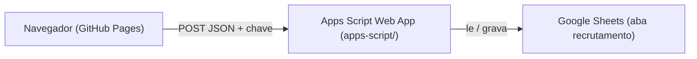

# Painel de Recrutamento (UJC)

Site estatico hospedado no **GitHub Pages** que le e edita a aba `recrutamento` de uma planilha do Google Sheets, usando um **Google Apps Script** como API.



## Estrutura

```
.
├── index.html               # Pagina unica do site (login + painel)
├── assets/
│   ├── css/styles.css        # Estilos complementares (tons de vermelho)
│   └── js/
│       ├── config.js         # URL da API (unico arquivo a editar)
│       ├── utils.js          # Helpers (escape de HTML, datas, WhatsApp)
│       ├── api.js            # Comunicacao com o Apps Script e sessao
│       └── app.js            # Logica da interface
├── apps-script/              # Backend: colar no editor do Apps Script da planilha
│   ├── Api.gs                # doPost: roteia as acoes do site
│   ├── Auth.gs               # Chaves de acesso (proprietario / leitura)
│   ├── Candidatos.gs         # Leitura e escrita dos candidatos
│   ├── Config.gs             # Celulas, recrutadores (CMRD), colunas
│   ├── Importacao.gs         # Importacao de outra planilha (menu)
│   ├── Menu.gs               # Menu da planilha
│   ├── Planilha.gs           # Criacao/verificacao da aba
│   ├── Utils.gs              # Helpers
│   └── appsscript.json       # Manifesto
└── .nojekyll
```

## Permissoes

| Perfil | Como entra | O que pode fazer |
| :--- | :--- | :--- |
| **Proprietario** | Chave do proprietario | Ver tudo, alterar status, atribuir recrutador, registrar anotacoes |
| **Recrutadores** | Chave de leitura | Ver candidatos, filtros, graficos e abrir WhatsApp (somente leitura) |

As chaves ficam nas **Propriedades do Script**, nunca no repositorio. As permissoes sao verificadas **no servidor** (Apps Script): mesmo que alguem altere o JavaScript do site, nao consegue editar sem a chave do proprietario.

A importacao de outras planilhas fica apenas no menu da propria planilha.

---

## Passo 1: Backend (Apps Script)

1. Abra a planilha > **Extensoes > Apps Script**.
2. Crie um arquivo de script para cada `.gs` da pasta `apps-script/` (mesmos nomes) e cole o conteudo.
3. Em **Configuracoes do projeto**, marque "Mostrar arquivo de manifesto appsscript.json" e cole o conteudo de `apps-script/appsscript.json`.
4. Salve e recarregue a planilha. Vai aparecer o menu **Painel de Recrutamento**.
5. Clique em **Painel de Recrutamento > Configurar chaves de acesso** e autorize. Anote as duas chaves.
6. No editor do Apps Script: **Implantar > Nova implantacao > App da Web**:
   - Executar como: **Eu**
   - Quem pode acessar: **Qualquer pessoa**
7. Copie a URL gerada (termina em `/exec`).

> Sempre que alterar os arquivos `.gs`, va em **Implantar > Gerenciar implantacoes > Editar > Nova versao** para publicar as mudancas mantendo a mesma URL.

## Passo 2: Frontend (GitHub Pages)

1. Edite `assets/js/config.js` e cole a URL em `API_URL`.
2. Envie para o GitHub:
   ```bash
   git init
   git add .
   git commit -m "Painel de recrutamento"
   git branch -M main
   git remote add origin https://github.com/SEU_USUARIO/SEU_REPOSITORIO.git
   git push -u origin main
   ```
3. No repositorio: **Settings > Pages > Source: Deploy from a branch > main / (root)**.
4. O site ficara em `https://SEU_USUARIO.github.io/SEU_REPOSITORIO/`.

## Testar localmente

Abra com qualquer servidor estatico, por exemplo:

```bash
npx serve .
# ou
python -m http.server 8000
```

## Personalizacao

- **Celulas e recrutadores:** edite `CELULAS_PADRAO` e `RECRUTADORES_INICIAIS` em `apps-script/Config.gs` (e publique nova versao).
- **Mensagem do WhatsApp:** `MENSAGEM_WHATSAPP` em `assets/js/config.js`.
- **Trocar as chaves** (ex.: alguem saiu do grupo): menu **Configurar chaves de acesso** novamente. As chaves antigas deixam de funcionar na hora.

